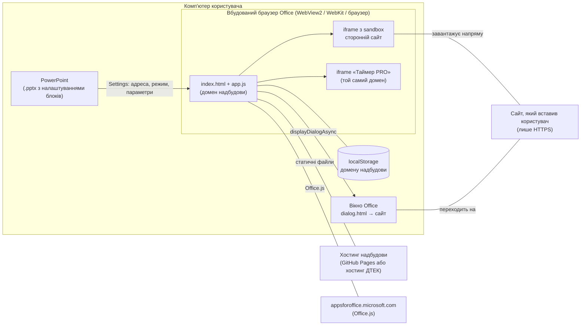

# «Веб на слайді»: матеріали для перевірки безпеки

Документ описує стан коду версії сайту **1.9.1** і маніфесту **1.2.0.0** (листопад 2026). Усе нижче можна перевірити за кодом у цьому репозиторії; посилання на рядки дано назвами файлів і функцій.

## 1. Що це і як працює

«Веб на слайді» є надбудовою вмісту (content add-in) PowerPoint. Автор вставляє на слайд блок, вказує адресу сайту або обирає вбудований інструмент тренера, і під час показу блок показує живу сторінку.

Це особистий проєкт Artem Usoltsev (DTEK Academy), зроблений поза робочими завданнями на власному обладнанні й ПЗ і безкоштовно поширений серед колег через Академію ДТЕК. Ліцензія MIT (`LICENSE`): ДТЕК може вільно використовувати, копіювати й змінювати код, зокрема розмістити власну копію.

Надбудова складається лише зі статичних файлів (HTML, JavaScript, CSS, шрифти, іконки). Немає серверної частини, бази даних, облікових записів, API-ключів, аналітики, реклами, збирання чи npm-залежностей. Код написано вручну, без мініфікації, тому його можна прочитати повністю.



Ключові властивості:

- Налаштування кожного блоку (адреса, режим, параметри інструментів) PowerPoint зберігає у файлі презентації через Office Settings API. Надбудова не має сервера, куди могла б їх надіслати.
- Сторонній сайт відкривається напряму з комп'ютера користувача в ізольованому iframe або в окремому вікні Office. Надбудова не проксує трафік і не бачить, що відбувається всередині сайту.

## 2. Дозволи (маніфест)

`manifest.xml`:

| Параметр | Значення | Що означає |
| --- | --- | --- |
| `Permissions` | `Restricted` | Найнижчий рівень. Доступні лише Settings (налаштування цієї вставки) і стан перегляду (редагування / показ). Надбудова **не може** читати чи змінювати текст, зображення, слайди, нотатки, теги презентації чи інші файли |
| `AllowSnapshot` | `false` | PowerPoint не зберігає у .pptx знімок вбудованої сторінки, тож вміст внутрішніх сайтів не потрапляє у файл. Наслідок: при друці, у PDF і в Teams PowerPoint Live порожня рамка |
| `AppDomains` | відсутні | Домен надбудови єдиний довірений. Сторонній сайт у вікні Office не може викликати `messageParent` і не може передати дані надбудові |
| `Requirements` | `Settings 1.1` | DialogApi та ActiveView перевіряються в коді через `isSetSupported` |
| `Hosts` | `Presentation` | Лише PowerPoint |

Перевірено: офіційний валідатор Microsoft (`npx office-addin-manifest validate manifest.xml`) на комп'ютері користувача видав «The manifest is valid» для PowerPoint Windows / Mac / web / iPad.

Office API, які викликає код (`app.js`, `dialog.js`):

| API | Навіщо |
| --- | --- |
| `Office.context.document.settings` (`get`, `set`, `saveAsync`) | Зберегти налаштування блоку у файлі |
| `Office.context.document.getActiveViewAsync`, подія `ActiveViewChanged` | Ховати кнопки керування під час показу |
| `Office.context.ui.displayDialogAsync` | Режим «У вікні» для сайтів, що забороняють вбудовування |
| `Office.context.displayLanguage`, `platform`, `requirements` | Мова інтерфейсу і перевірка підтримки API |

Інших Office API (PowerPoint JavaScript API, Graph, пошта, SSO, файли) код не використовує.

## 3. Які дані зберігаються і де

### У файлі презентації (Office Settings конкретного блоку)

Ключі з `app.js` (`KEY_*`): `url`, `mode`, `code`, `kind`, `widget`, `timerCfg`, `tabs`, `mainTitle`, `scale`, `scroll`, `qr`, `reveal`, `revealText`, `refresh`, `zoom`, `fx`, `fy`, `offline`, `border`, `rounded`, `cornerBg`, `autoplay`, `rotate`.

Це адреса сайту, код сесії (наприклад, Mentimeter), режим показу, оформлення і, для інструментів тренера, списки імен, команд, бали й налаштування таймера. Їх бачить кожен, хто має доступ до файлу.

Захисні заходи:

- адреси з логіном і паролем (`https://user:pass@…`) не приймаються (`config.js`, `cfg.check`);
- якщо в адресі є параметри, схожі на секрети (`token`, `key`, `secret`, `sig`, `signature`, `auth`, `password`, `pwd`, `access_token`), автор бачить попередження, що адреса збережеться відкритим текстом;
- в інструкції (`help.html`) прямо сказано не вставляти посилання доповідача чи адміністратора.

### У localStorage на комп'ютері (домен надбудови)

| Ключ | Що | Термін |
| --- | --- | --- |
| `webOnSlide.recent` | До 10 нещодавніх адрес | Поки користувач не очистить |
| `webOnSlide.templates` | До 50 особистих шаблонів блоків | Те саме |
| `webOnSlide.score:<команди>` | Спільний рахунок команд між слайдами | Забувається через 12 годин |
| `trainingTimer.v1`, `trainingTimer.clips.v1`, `trainingTimer.logo.v1` | Пресети, аудіокліпи й логотип «Таймера PRO» | Поки користувач не очистить |

Ці дані не потрапляють у файл і нікуди не надсилаються. Синхронізація рахунку між блоками йде через `BroadcastChannel` у межах одного комп'ютера.

### Чого надбудова не робить

- не збирає персональних даних, телеметрії чи аналітики;
- не має облікових записів, не запитує вхід, не використовує SSO;
- не читає файли користувача, крім тих, які користувач сам обирає в «Таймері PRO» (логотип, звук, музика, імпорт налаштувань); вони лишаються в браузері;
- не використовує мікрофон, камеру чи геолокацію в PowerPoint (шумомір і друге вікно «Таймера PRO» вимкнені в режимі `?embed=1`, а iframe таймера не має дозволу `microphone`).

## 4. Мережеві звернення

| Звідки | Куди | Коли | Обов'язково |
| --- | --- | --- | --- |
| PowerPoint | Хостинг надбудови (`artemusoltsev.github.io` або хостинг ДТЕК) | Завжди: `manifest.xml`, HTML, JS, іконки, шрифти таймера | Так |
| `index.html`, `dialog.html` | `appsforoffice.microsoft.com` | Завжди: бібліотека Office.js | Так |
| Office.js | `*.microsoft.com`, `*.office.com`, `*.office.net` | Службові звернення Office.js (телеметрія Microsoft) | Так, за правилами Microsoft |
| iframe блоку або вікно Office | Сайт, який вставив користувач (лише HTTPS) | Коли блок показує сайт | Ні, обмежується `allowedOrigins` |
| «Таймер PRO» | Адреса логотипу, якщо користувач сам вказав логотип за посиланням | Лише за такого налаштування | Ні |

Надбудова **не** звертається до Google Fonts, CDN бібліотек, сервісів QR-кодів, аналітики чи будь-яких інших сторонніх служб. QR-коди генеруються локально (`vendor/qrcode.js`, ліниве завантаження з того самого домену). Шрифти «Таймера PRO» лежать у `timer/fonts/`.

«Розумні посилання» (`cfg.embedRules` у `config.js`) лише переписують адресу, яку ввів користувач, на офіційну embed-адресу того ж сервісу (YouTube → `youtube.com/embed`, Vimeo → `player.vimeo.com`, Google Docs → `/preview`, Miro, Figma, Canva). Нових доменів, яких користувач не вказував, вони не додають, крім `player.vimeo.com` для Vimeo.

Перевірити самостійно: `grep -rnoE "https://[a-zA-Z0-9._/-]+" --include=*.html --include=*.js .` покаже всі адреси в коді; крім `appsforoffice.microsoft.com` це лише приклади в коментарях, шаблони швидких адрес (`menti.com`, `kahoot.it`) і правила розумних посилань.

## 5. Ізоляція: CSP і sandbox

### Content-Security-Policy (meta-теги)

| Сторінка | Політика |
| --- | --- |
| `index.html` | `default-src 'self'; script-src 'self' https://appsforoffice.microsoft.com; style-src 'self' 'unsafe-inline'; img-src 'self' data: https:; connect-src 'self' https://appsforoffice.microsoft.com https://*.microsoft.com https://*.office.com https://*.office.net; frame-src 'self' https:; object-src 'none'; base-uri 'none'; form-action 'self';` |
| `index.html`, якщо заповнено `allowedOrigins` | Додається другий CSP `frame-src 'self' <список>`. Браузер застосовує обидва, тому список обмежує і переходи всередині iframe, а не лише першу адресу (`applyFrameCsp` в `app.js`) |
| `dialog.html` | `default-src 'self'; script-src 'self' https://appsforoffice.microsoft.com; style-src 'unsafe-inline'; connect-src 'self' https://appsforoffice.microsoft.com https://*.microsoft.com https://*.office.com https://*.office.net; object-src 'none'; base-uri 'none';` |
| `timer/index.html` | `default-src 'self'; script-src 'self'; style-src 'self' 'unsafe-inline'; font-src 'self'; img-src 'self' data: blob: https:; media-src 'self' data: blob: https:; connect-src 'self'; object-src 'none'; base-uri 'none'; form-action 'none';` |
| `help.html`, `help-en.html`, `privacy.html` | `default-src 'self'; style-src 'unsafe-inline'; img-src 'self'; object-src 'none'; base-uri 'none';` (скриптів немає) |

На жодній сторінці немає `script-src 'unsafe-inline'` чи `'unsafe-eval'`; код не використовує `eval`, `new Function` чи рядкові `setTimeout`.

### iframe стороннього сайту (`#frame` в `index.html`)

```
sandbox="allow-scripts allow-same-origin allow-forms allow-pointer-lock allow-popups
         allow-popups-to-escape-sandbox allow-modals allow-storage-access-by-user-activation"
allow="fullscreen; autoplay; clipboard-write; gamepad"
referrerpolicy="strict-origin-when-cross-origin"
```

- `allow-scripts` + `allow-same-origin` потрібні, щоб звичайні сайти (Mentimeter, ігри) працювали. Це безпечно, бо сайт завжди з **іншого** origin: `cfg.check` відхиляє адреси з домену самої надбудови (причина `self`), тож сайт не може дістатися до сторінки надбудови чи Office API.
- `allow-top-navigation` не надано: сайт не може перевести блок на іншу сторінку.
- Камера, мікрофон, геолокація, платежі в `allow` не надані.

### Перевірка адрес (`cfg.check` у `config.js`)

Одна функція для блоку, вікна й QR: лише `https:`; без пробілів; має бути домен; без логіна й пароля; не власний домен надбудови; не в `blockedOrigins`; якщо `allowedOrigins` не порожній, лише з нього; попередження про секрети в параметрах. Остаточна адреса (після підстановки коду сесії й «розумного посилання») перевіряється ще раз перед показом і перед відкриттям вікна.

### Вікно Office (`dialog.html` → сайт)

Office вимагає, щоб вікно спершу відкрило сторінку з домену надбудови. `dialog.js` перевіряє адресу тими ж правилами й переходить на неї. Відкрита поза Office (наприклад, з фішингового листа), сторінка нікуди не переходить автоматично, а показує адресу й посилання, тож домен надбудови не можна використати як відкритий редирект.

### «Таймер PRO» (`timer/index.html`)

Таймер вантажиться з **того самого** домену в iframe з `sandbox="allow-scripts allow-same-origin allow-forms"`, тобто має доступ до сторінки надбудови (так він читає й зберігає свої налаштування через `window.WOS_TIMER_HOST`). Тому його код вважається частиною надбудови, а дані з файлу перевіряються:

- налаштування з .pptx обмежено 200 000 символів;
- список учасників приводиться до `{name: рядок, score: число}` (`cleanRoster`), усі значення екрануються під час виводу (`esc`);
- CSP `script-src 'self'` без `'unsafe-inline'`: навіть якщо в розмітку потрапить чужий HTML, обробники на кшталт `onerror` не виконаються.

## 6. Модель загроз

| # | Загроза | Захист | Залишковий ризик |
| --- | --- | --- | --- |
| T1 | Підмінений код на хостингу (зламаний акаунт GitHub, шкідливий коміт) змінює поведінку надбудови в усіх презентаціях | Restricted: навіть зламаний код не може читати слайди. Рекомендовано: захист гілки `main`, обов'язковий рев'ю (`CODEOWNERS`), 2FA, а для продуктиву хостинг під контролем ДТЕК із розгортанням перевіреного тегу (див. `docs/admin-deployment.md`) | Середній, поки хостинг на особистому GitHub Pages |
| T2 | Шкідливий вбудований сайт атакує надбудову чи Office | Інший origin + sandbox; власний домен заблоковано; немає `AppDomains`; немає `allow-top-navigation` | Низький |
| T3 | Підроблений .pptx із шкідливими налаштуваннями (збережений XSS) | Налаштування виводяться через `textContent`; адреси перевіряються при кожному показі; JSON віджетів і таймера перевіряється й обрізається; CSP без inline-скриптів | Низький. Виправлено знахідку HIGH у «Таймері PRO» (1.9.1) |
| T4 | Витік даних через файл (адреси, коди, імена учасників) | `AllowSnapshot=false`; заборона логінів у адресі; попередження про токени; інструкція користувача | Низький: дані у файлі бачить кожен, хто має файл (як і будь-який вміст презентації) |
| T5 | Відкритий редирект через `dialog.html?u=` | Поза Office лише показ адреси й посилання (1.7.1) | Низький |
| T6 | Користувач вставляє фішинговий чи небажаний сайт | `allowedOrigins` / `blockedOrigins` у `config.js`; адмін вирішує, чи вмикати білий список | Залежить від політики: за замовчуванням дозволено будь-який HTTPS-сайт |
| T7 | Компрометація Office.js на CDN Microsoft | Довіра до Microsoft; SRI неможливий, бо Microsoft оновлює `office.js` на місці | Прийнятий, однаковий для всіх надбудов Office |
| T8 | Вичерпання ресурсів на великих презентаціях | Інструкція: до 10 блоків без проблем; таймер оновлюється не частіше 20 разів на секунду, а коли стоїть, покадровий цикл зупиняється | Див. розділ 8 |

## 7. Відомі залишкові ризики й обмеження

1. **Хостинг на особистому GitHub Pages** (`artemusoltsev.github.io`). Хто має доступ на запис до репозиторію, той змінює код для всіх користувачів одразу. GitHub Pages не дає задати HTTP-заголовки (лише CSP через meta, без `frame-ancestors`). Рекомендація: для продуктиву розмістити копію перевіреного тегу на хостингу ДТЕК.
2. **За замовчуванням дозволено будь-який HTTPS-сайт** (`allowedOrigins: []`). Якщо політика компанії вимагає, заповніть білий список; він потрапляє і в CSP.
3. `frame-src https:` та `img-src https:` в `index.html` широкі за замовчуванням: це потрібно для універсальності; звужуються білим списком.
4. `style-src 'unsafe-inline'`: дозволено лише стилі, не скрипти.
5. Адреса `https://localhost` проходить перевірку (для розробки). За потреби додайте `https://localhost` у `blockedOrigins`.
6. localStorage спільний для всіх сторінок домену `artemusoltsev.github.io` (інших сайтів на цьому домені немає; на власному хостингу ДТЕК питання знімається).
7. Сторонні сайти отримують IP-адресу користувача й можуть ставити свої cookie, як при звичайному відкритті в браузері.
8. Протестовано в PowerPoint для Windows (Microsoft 365, WebView2) і в Chromium з імітацією Office. На Mac, iPad і в PowerPoint для вебу реальних тестів ще не було.

## 8. Продуктивність і ресурси

Вимір у справжньому PowerPoint (i5-11300H, 16 ГБ, PowerPoint 16.0.17932, демо-презентація на 53 слайди з 47 блоками, версія 1.9.0):

- PowerPoint не вивантажує блоки, які вже показувалися: кожен відвіданий блок тримає приблизно один процес WebView2 і 120–130 МБ пам'яті;
- після проходу всіх слайдів: 57 процесів, 6,8 ГБ; усе звільняється при закритті файлу;
- перехід між слайдами в середньому 74 мс, максимум 1,1 с.

Рекомендація для користувачів: до 10 блоків без обмежень, 20–30 відчутно на комп'ютерах з 8 ГБ, понад 40 краще розділити на кілька файлів. Власний код надбудови займає близько 58 КБ у gzip.

## 9. Ланцюг постачання

- Немає `package.json`, збирання, мініфікації чи автоматичних залежностей: у репозиторії рівно те, що віддає хостинг.
- Сторонній код (вендорені копії): `vendor/qrcode.js` (qrcode-generator 1.4.4, Kazuhiko Arase, MIT) і шрифти `timer/fonts/` (@fontsource 5.3.0, OFL-1.1 / UFL-1.0). Див. [THIRD-PARTY-NOTICES.md](../THIRD-PARTY-NOTICES.md).
- Під час роботи завантажується лише `office.js` з `appsforoffice.microsoft.com`.

## 10. Історія перевірок

| Дата | Що перевірялося | Результат |
| --- | --- | --- |
| 2026-11-05 | Повний аудит коду й маніфесту 1.1 | 30 знахідок, критичних немає. Виправлено у 1.2.0.0: `Restricted` замість `ReadWriteDocument`, `AllowSnapshot=false`, єдина перевірка адрес, білий список у CSP, заборона логінів в адресі, захист від запуску поза Office |
| 2026-11-10 | Аудит версії 1.7 | 1 високий (спільний код сесії через теги презентації не працює під `Restricted`), 7 середніх (зокрема відкритий редирект `dialog.html?u=`). Виправлено в 1.7.1 і 1.7.2; функцію, що потребувала вищого дозволу, прибрано, дозвіл не підвищувався |
| 2026-11-10 | Перевірка доступності (axe) і UI/UX | 0 серйозних порушень доступності; виправлення в 1.9.0 |
| 2026-11-11 | Маніфест, безпека, продуктивність версії 1.9 | HIGH: збережений XSS у «Таймері PRO» через бали з підробленого .pptx; надмірне навантаження таймера; звернення до Google Fonts. Усе виправлено в 1.9.1. Маніфест пройшов офіційний валідатор |
| 2026-11-10 | Живий тест у PowerPoint для Windows (Restricted) | Встановлення через каталог надбудов, вбудовування сайтів, приховування кнопок у показі, вікно Office, спільний рахунок працюють |

Аудити виконано власником проєкту за допомогою інструментів ШІ (Claude); незалежного зовнішнього аудиту ще не було.

## 11. Як перевірити самостійно

1. Склонуйте репозиторій і зафіксуйте коміт або тег, який перевіряєте.
2. Перевірте маніфест: `npx office-addin-manifest validate manifest.xml`.
3. Знайдіть усі зовнішні адреси: `grep -rnoE "https://[a-zA-Z0-9._/-]+" --include=*.html --include=*.js .`
4. Знайдіть небезпечні конструкції: `grep -rnE "eval\(|new Function|document\.write|innerHTML" --include=*.js .` (у `timer.js` `innerHTML` використовується лише з екранованими значеннями через `esc`).
5. Переконайтеся, що хостинг віддає ті самі файли, що й перевірений коміт:
   ```sh
   for f in $(git ls-files); do
     curl -s "https://artemusoltsev.github.io/web-on-slide/$f" | sha256sum | sed "s|-|$f|"
   done > served.txt
   git ls-files | xargs sha256sum > repo.txt
   diff repo.txt served.txt
   ```
   (Файли `.md`, `.github/` і `docs/` на роботу надбудови не впливають.)
6. Відкрийте надбудову в PowerPoint з DevTools (WebView2: правий клік у блоці → Inspect, якщо дозволено політикою) і перегляньте вкладку Network: крім хостингу, Office.js і самого вбудованого сайту звернень бути не повинно.
